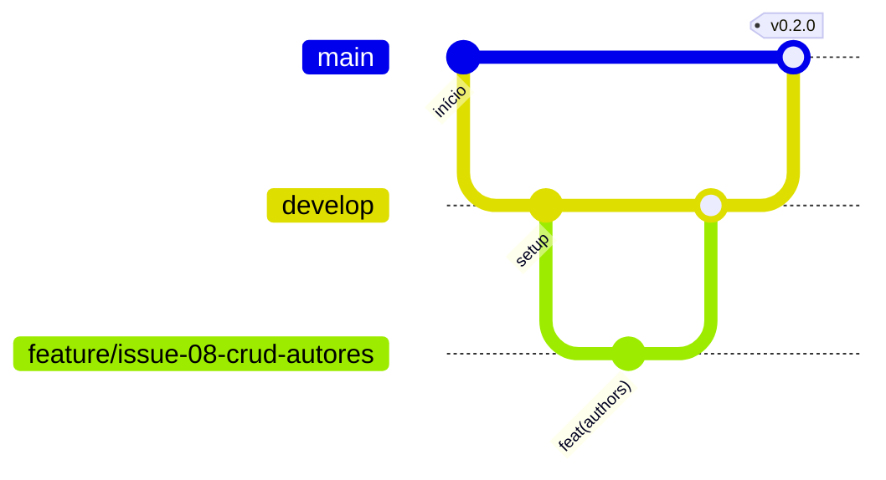

# 📚 BookShelf API


API REST para catalogar livros e autores e acompanhar o progresso de leitura.

## O problema
Quem lê bastante acaba com informações espalhadas em planilhas, notas e memória: o que já leu, o que está lendo, o que quer ler e o que achou de cada livro. A BookShelf API centraliza esse catálogo pessoal em um serviço simples, pesquisável e documentado.

## Funcionalidades

| Funcionalidade | Requisito | Status |
|---|---|---|
| CRUD de autores | RF01–RF03 | ✅ Implementado |
| Exclusão de autor protegida (sem livros vinculados) | RF04 | ✅ Implementado |
| CRUD de livros | RF05–RF09 | ✅ Implementado |
| Busca, filtros e paginação | RF06, RF10 | ✅ Implementado |
| Status de leitura | RF11 | ✅ Implementado |
| Avaliação de 1 a 5 (livros lidos) | RF12 | ✅ Implementado |
| Resumo estatístico da biblioteca | RF13 | ✅ Implementado |
| Autenticação e múltiplos usuários | — | 🗓️ Planejado |
| Importação de dados via API externa | — | 🗓️ Planejado |

> Atualize a coluna *Status* conforme as issues forem concluídas.

## Stack
Python 3.11+ · FastAPI · SQLAlchemy 2 · SQLite · Pytest · GitHub Actions

## Instalação e execução

```bash
# 1. Clonar
git clone https://github.com/SEU-USUARIO/bookshelf-api.git
cd bookshelf-api

# 2. Criar e ativar o ambiente virtual
python -m venv .venv
source .venv/bin/activate          # Windows: .venv\Scripts\activate

# 3. Instalar dependências (inclui as de teste)
pip install -r requirements-dev.txt

# 4. Subir a API
uvicorn app.main:app --reload --app-dir src
```

- API: http://127.0.0.1:8000
- Documentação interativa (Swagger): http://127.0.0.1:8000/docs
- Banco: arquivo `bookshelf.db` criado na primeira execução (configurável via variável `DATABASE_URL`).

### Rodando os testes
```bash
pytest --cov=app --cov-report=term-missing
```

## Endpoints

| Método | Rota | Descrição |
|---|---|---|
| POST / GET | `/authors` | Cadastrar / listar autores |
| GET / PUT / DELETE | `/authors/{id}` | Consultar / editar / excluir autor |
| POST / GET | `/books` | Cadastrar / buscar livros (`title`, `author`, `author_id`, `category`, `status`, `limit`, `offset`) |
| GET / PUT / DELETE | `/books/{id}` | Consultar / editar / excluir livro |
| PATCH | `/books/{id}/status` | Alterar status de leitura |
| PATCH | `/books/{id}/rating` | Avaliar livro lido (1 a 5) |
| GET | `/books/stats` | Resumo da biblioteca |
| GET | `/health` | Verificação de saúde |

Exemplo:
```bash
curl -X POST localhost:8000/authors -H "Content-Type: application/json" \
     -d '{"name": "Machado de Assis"}'
curl -X POST localhost:8000/books -H "Content-Type: application/json" \
     -d '{"title": "Dom Casmurro", "author_id": 1, "category": "Romance"}'
```

## Documentação do projeto

| Documento | Conteúdo |
|---|---|
| [Project Charter](docs/project-charter.md) | Justificativa, objetivos SMART, escopo e stakeholders |
| [Requisitos](docs/requisitos.md) | RFs, RNFs e regras de negócio, com rastreabilidade |
| [Casos de Uso](docs/casos-de-uso.md) | Atores e fluxos principais, alternativos e de exceção |
| [User Stories](docs/user-stories.md) | Histórias com critérios de aceite em Gherkin |
| [Modelo de Dados e Arquitetura](docs/der.md) | DER e visão em camadas |

## Fluxo de trabalho (Git Flow)

| Branch | Origem | Destino | Uso |
|---|---|---|---|
| `main` | — | — | Produção. Só recebe merges de `develop` e é marcada com tags SemVer. **Sem commits diretos.** |
| `develop` | `main` | `main` | Integração contínua do trabalho. |
| `feature/issue-NN-descricao` | `develop` | `develop` | Uma branch por issue (ex.: `feature/issue-08-crud-autores`). |
| `docs/issue-NN-descricao` | `develop` | `develop` | Issues de documentação. |



**Convenções**
- **Commits:** [Conventional Commits](https://www.conventionalcommits.org/pt-br/) com referência à issue, ex.: `feat(books): permitir filtrar por categoria (#11)`.
- **Versionamento:** [SemVer](https://semver.org/lang/pt-BR/) com tags anotadas (`v0.1.0` a `v0.4.0`).
- **Rastreabilidade:** todo PR referencia sua issue com `Closes #N`.

## Versões

| Tag | Marco |
|---|---|
| v0.1.0 | Estrutura, documentação e README |
| v0.2.0 | Persistência e CRUD de autores e livros |
| v0.3.0 | Busca, status, avaliação e estatísticas |
| v0.4.0 | Testes automatizados e CI |

## Licença
Distribuído sob a licença MIT. Veja [LICENSE](LICENSE).
